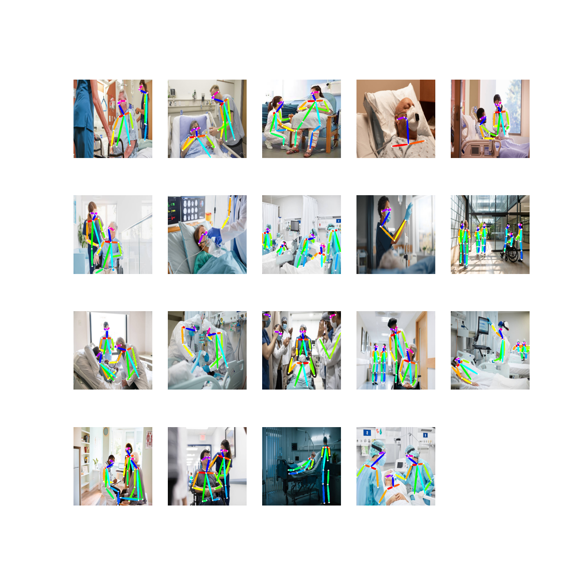

# Medical OpenPose - Patient Skeletal Analysis System

## Overview
Computer vision pipeline for clinical movement analysis using OpenPose to extract patient skeletal keypoints and quantitatively assess physical rehabilitation progress.

## Tech Stack
- **Deep Learning**: PyTorch (GPU/CUDA)
- **Computer Vision**: OpenPose keypoint detection
- **Data**: MSCOCO dataset + custom medical data pipelines
- **Monitoring**: TensorBoard
- **Environment**: Jupyter Notebook

## Key Features
- Extract 25+ anatomical landmarks from patient video input
- End-to-end pipeline from raw video to quantitative movement metrics
- Real-time GPU-accelerated inference (30+ FPS)
- Supports gait analysis, range-of-motion tracking, and post-surgical rehabilitation assessment

## Project Structure
```
OpenPose/
├── MSCOCO_download.ipynb      # Dataset preparation
├── train.ipynb                # Model training
├── train_gpu.ipynb            # GPU-accelerated training
├── OpenPose_Inference.ipynb   # General inference
├── Inference_Patient.ipynb    # Patient-specific analysis
├── dataloader_test.ipynb      # Data validation
├── tensorboard.ipynb          # Training monitoring
└── utils/                     # Data processing utilities
```

## How to Run

### Prerequisites
- Python 3.8+, PyTorch with CUDA support
- NVIDIA GPU

### Installation
```bash
git clone https://github.com/ark0723/MyProject.git
cd MyProject/OpenPose

pip install torch torchvision torchaudio
pip install opencv-python jupyter tensorboard
```

### Workflow
```bash
# 1. Download base dataset
jupyter notebook MSCOCO_download.ipynb

# 2. Train model
jupyter notebook train_gpu.ipynb

# 3. Run patient analysis
jupyter notebook Inference_Patient.ipynb
```

## Results


*Skeletal keypoint detection output. Keypoint detection rate >95% for major joints.*
